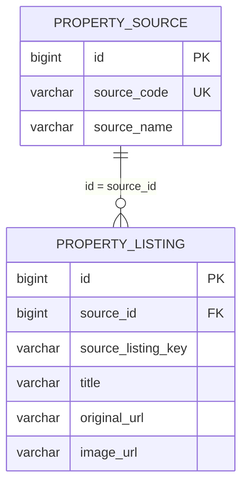

# アツイエ 팀원용 DB 구조·입력 안내

기준일: 2026-11-06. 실제 Supabase의 컬럼·기본값·제약 조건과 현재 Spring 코드를 대조한 문서입니다. 비밀번호나 API 키는 포함하지 않습니다.

## 1. 어디서 확인하나요?

DB는 **Supabase PostgreSQL**이며 부동산 데이터는 **`house_app` 스키마**에 있습니다.

[우리 프로젝트의 Table Editor](https://supabase.com/dashboard/project/ujwzjjoqyfazdgmfdcoj/editor) → 스키마 선택 메뉴에서 **`public` 대신 `house_app`** → 테이블 선택 순서로 들어갑니다. 팀원이 대시보드에서 작업하려면 조직 초대를 수락하고 적절한 권한으로 로그인해야 합니다.

| 테이블 | 역할 | 확인 시점의 데이터 |
|---|---|---:|
| `house_app.property_source` | 원본 부동산 사이트 정보 | 4건 |
| `house_app.property_listing` | 각 사이트에서 수집한 매물 정보 | 583건 |

이 프로젝트에서 사용하는 테이블은 위 두 개입니다. 같은 Supabase의 `public`에 있는 다른 앱의 테이블은 이 부동산 프로젝트의 테이블이 아닙니다. 회원·리뷰·학교·역 간 이동 시간 등을 저장하는 테이블은 아직 이 스키마에 구현하지 않았습니다.

## 2. 두 테이블의 관계



예를 들어 `property_source.id = 1`은 현재 SUUMO입니다. SUUMO에서 수집한 매물은 `property_listing.source_id = 1`로 연결합니다. **사이트 하나에 매물 여러 개가 연결되는 1:N 관계**입니다.

`id`는 각 행의 고유 번호인 기본키(PK), `source_id`는 출처의 번호를 참조하는 외래키(FK)입니다. 아래 도표의 NULL 허용은 값이 없어도 DB가 저장을 허용하는지를 뜻합니다. NULL 불가여도 자동 생성·기본값이 있는 컬럼은 새 행을 만들 때 직접 입력하지 않아도 됩니다.

## 3. property_source — 원본 사이트 정보

| 컬럼 | PostgreSQL 자료형 | NULL 허용 | 의미·입력 예시 |
|---|---|---|---|
| `id` | `BIGINT` | 불가 | 사이트 고유 번호. 자동 생성되므로 새 행에서는 직접 지정하지 않습니다. 예: `1` |
| `source_code` | `VARCHAR(50)` | 불가 | 코드에서 사용하는 사이트 식별자. 중복 불가. 예: `suumo` |
| `source_name` | `VARCHAR(100)` | 불가 | 화면에 표시할 사이트 이름. 예: `SUUMO` |
| `base_url` | `VARCHAR(512)` | 불가 | 사이트의 기본 주소. 예: `https://suumo.jp` |
| `is_enabled` | `BOOLEAN` | 불가 | 수집 사용 여부. 기본값 `true`. `false`이면 해당 출처의 수집·저장을 중지합니다. |
| `created_at` | `TIMESTAMP WITHOUT TIME ZONE` | 불가 | 출처를 우리 DB에 처음 등록한 시각. 기본값으로 자동 입력됩니다. |

실제 등록되어 있는 출처는 다음과 같습니다. ID는 현재 공용 DB 기준이므로, 다른 DB를 새로 만들었다면 해당 DB에서 다시 확인합니다.

| id | source_code | source_name | base_url |
|---:|---|---|---|
| 1 | `suumo` | SUUMO | `https://suumo.jp` |
| 2 | `homes` | LIFULL HOME’S | `https://www.homes.co.jp` |
| 3 | `athome` | at home | `https://www.athome.co.jp` |
| 4 | `leopalace` | 레오팔레스21 | `https://www.leopalace21.com` |

**`is_enabled = false`는 기존 매물을 화면에서 숨기는 설정이 아닙니다.** 현재 목록은 매물의 `status`를 기준으로 표시합니다. 또한 DB에 사이트 행만 추가해도 새 사이트의 크롤링이 구현되지는 않습니다. 출처 정의와 사이트별 파싱 코드를 함께 작성해야 합니다.

## 4. property_listing — 매물 정보

| 컬럼 | PostgreSQL 자료형 | NULL 허용 | 의미·입력 예시 |
|---|---|---|---|
| `id` | `BIGINT` | 불가 | 우리 DB의 매물 고유 번호. 자동 생성되므로 새 행에서는 직접 지정하지 않습니다. |
| `source_id` | `BIGINT` | 불가 | 원본 사이트 번호. `property_source.id`에 실제로 있는 값이어야 합니다. 예: 레오팔레스는 현재 `4` |
| `source_listing_key` | `VARCHAR(200)` | 불가 | 같은 출처 안에서 매물을 구분하는 키. 현재 수집 코드는 정규화한 상세 URL의 해시로 `url:…` 형식을 만듭니다. |
| `title` | `VARCHAR(255)` | 불가 | 매물 이름·호실. 예: `レオパレスサクラパークＡ · 102号室` |
| `original_url` | `VARCHAR(2048)` | 불가 | **카드를 누르면 이동할 원본 사이트의 해당 매물 상세 페이지 주소**. 사이트 메인 주소와 구분합니다. |
| `prefecture` | `VARCHAR(50)` | 가능 | 도도부현. 예: `東京都`, `北海道`, `大阪府` |
| `city` | `VARCHAR(100)` | 가능 | 도시·구. 예: `豊島区`, `世田谷区`, `旭川市` |
| `address` | `VARCHAR(500)` | 가능 | 매물의 전체 주소. 예: `東京都豊島区駒込６−６−４` |
| `rent_yen` | `INTEGER` | 가능 | 월세, **엔 단위 정수**. 예: `106000` = 월 106,000엔. 0 이상. |
| `management_fee_yen` | `INTEGER` | 가능 | 관리비, **엔 단위 정수**. 예: `6500`. 0 이상. |
| `layout` | `VARCHAR(30)` | 가능 | 방 구조. 예: `1R`, `1K`, `1LDK`, `2LDK` |
| `area_m2` | `NUMERIC(8,2)` | 가능 | 전용 면적, **㎡ 단위 숫자**. 예: `19.87`. 0보다 커야 합니다. |
| `station_name` | `VARCHAR(100)` | 가능 | 가장 가까운 역 등 원본에 기재된 역 이름. 예: `巣鴨駅` |
| `walk_minutes` | `SMALLINT` | 가능 | 역까지 걸리는 **도보 시간(분)**. 예: `10`. 0 이상. 지하철 탑승 시간이나 버스 시간이 아닙니다. |
| `image_url` | `VARCHAR(2048)` | 가능 | **대표 사진을 불러올 이미지 주소**. 사진 파일 자체는 저장하지 않습니다. |
| `status` | `VARCHAR(20)` | 불가 | 우리 사이트의 표시 상태. 기본값 `ACTIVE`. 허용값은 `ACTIVE`, `INACTIVE`, `UNKNOWN`입니다. |
| `last_seen_at` | `TIMESTAMP WITHOUT TIME ZONE` | 불가 | 원본에서 해당 매물을 마지막으로 확인한 시각. 수집 시 갱신하며 새 행에는 기본 시각도 있습니다. |
| `created_at` | `TIMESTAMP WITHOUT TIME ZONE` | 불가 | 우리 DB에 매물을 처음 저장한 시각. 기본값 자동 입력. 원본 사이트의 게시일이 아닙니다. |
| `updated_at` | `TIMESTAMP WITHOUT TIME ZONE` | 불가 | 우리 DB의 마지막 수정 시각. 최초 저장 때 기본값이 들어가고, 행이 UPDATE되면 DB 트리거가 자동 갱신합니다. |

시간 컬럼에는 타임존 정보가 별도로 저장되지 않습니다. 현재 앱은 일본 표준시 `Asia/Tokyo`(UTC+9)를 기준으로 저장하며 DB 기본값·수정 트리거도 같은 기준입니다. 한국도 UTC+9입니다.

### 상태값과 중복 처리

| status | 현재 화면에서의 처리 |
|---|---|
| `ACTIVE` | 목록·홈의 매물 조회 대상 |
| `INACTIVE` | 매물 조회 대상에서 제외 |
| `UNKNOWN` | 매물 조회 대상에서 제외 |

`ACTIVE`는 원본에서 지금도 계약 가능한 집이라는 보증이 아닙니다. 현재 수집 코드는 확인한 매물을 ACTIVE로 저장·갱신하며, 이번 수집 목록에 없었다는 이유만으로 기존 행을 자동 종료시키지는 않습니다. 최신 모집 여부는 원본 사이트에서 확인합니다.

`(source_id, source_listing_key)` 조합은 중복 저장할 수 없습니다. 같은 조합을 크롤링으로 다시 받으면 새 행을 늘리는 대신 기존 행의 가격·주소·사진 URL·상태 등을 갱신합니다. 다른 사이트에서 같은 집을 올린 경우에는 출처가 다르므로 별개의 행으로 저장될 수 있습니다. 출처 간 동일 주택 통합 기능은 아직 없습니다.

## 5. 사진은 파일이 아니라 URL을 넣습니다

**`image_url`에 인터넷에서 접근 가능한 사진 주소 문자열을 넣습니다.** DB에 JPG·PNG 파일, 바이너리, Base64 데이터를 넣거나 Supabase Storage에 사진을 업로드하는 방식은 현재 사용하지 않습니다. 한 매물당 대표 사진 주소 1개를 저장합니다.

| 구분 | 입력하는 내용 | 쓰임 |
|---|---|---|
| `base_url` | `https://www.leopalace21.com` | 출처 사이트의 기본 주소 |
| `original_url` | 원본 사이트의 매물 상세 페이지 주소 | 매물 카드를 클릭했을 때 이동 |
| `image_url` | 원본 사진 또는 이미지 CDN의 사진 주소 | 카드의 대표 사진 표시 |

실제 DB에 저장된 예시입니다. 원본 사이트의 공개 상태에 따라 이후 변경될 수 있습니다.

```text
original_url:
https://www.leopalace21.com/properties/chintai/tokyo/toshima-ku-13116/sakura-park-a-36044/102

image_url:
https://leopalace21.imagewave.pictures/LoRXZgo7qt6twWP8tuWJ1w/FXQudNehXrW8yPpiGYKnaf/mcontain
```

이미지 주소가 반드시 `.jpg`나 `.png`로 끝날 필요는 없습니다. 위 예시처럼 확장자가 없어도 해당 주소가 이미지 응답을 주면 사용할 수 있습니다.

화면에서는 다음 흐름으로 사진을 표시합니다.

```text
DB의 image_url 문자열
  → Spring 조회 결과의 imageUrl 필드
  → Thymeleaf가  생성
  → 사용자의 브라우저가 외부 이미지 서버에서 사진 로딩
```

팀원이 사진을 바꿀 때는 다음을 확인합니다.

1. 가능하면 원본 사이트 사진의 **이미지 주소 복사** 기능으로 주소를 가져옵니다. 매물 설명 페이지 주소를 `image_url`에 넣지 않습니다.
2. HTTPS 주소를 새 탭에서 열었을 때 사진이 직접 표시되는지 확인합니다. 로그인 세션이나 임시 링크에 의존하는 주소는 다른 사용자에게 표시되지 않을 수 있습니다.
3. `image_url` 셀에 주소를 텍스트로 저장합니다. `C:\Users\...\house.jpg`, `file://...`, PC의 파일명, 사진 파일 첨부는 사용하지 않습니다.
4. 우리 사이트를 새로 조회해 사진이 표시되는지 확인합니다. 외부 서버의 링크 만료·삭제·외부 사용 제한에 따라 나중에 표시되지 않을 수도 있습니다.
5. 사진을 모르면 `NULL`로 둡니다. 현재 화면은 주소가 없거나 로딩에 실패하면 사진 준비 중 표시를 사용합니다.

현재 크롤링 저장 과정은 출처별로 확인한 HTTPS 이미지 호스트만 허용합니다. Table Editor에서 직접 수정하면 이 Java Service 검증을 거치지 않으므로 주소를 직접 확인해야 합니다. 원본 링크도 해당 출처의 실제 매물 상세 페이지인지 확인합니다.

## 6. 팀원이 직접 수정할 때의 입력 규칙

- **금액에는 숫자만** 넣습니다. 월세 8만 5천 엔은 `85000`입니다. `8.5万円`, `85,000円`이나 원화 환산액을 넣지 않습니다.
- **면적·도보 시간에도 단위를 붙이지 않습니다.** `area_m2 = 23.18`, `walk_minutes = 7`처럼 입력합니다.
- **정보 없음과 0을 구분합니다.** 관리비를 모르면 `NULL`, 원본에서 무료라고 명확히 표시했으면 `0`입니다. 문자 `"NULL"`이나 빈 문자열로 대체하지 않습니다.
- **지역 표기를 기존 값과 맞춥니다.** `prefecture`에는 `도쿄` 대신 기존 DB와 같은 `東京都`, `홋카이도` 대신 `北海道`를 사용합니다. 구조도 기존 코드 형식인 `1K` 등을 사용합니다. 값이 다르면 필터에서 누락될 수 있습니다.
- **번호·중복 키는 일반 수정 대상이 아닙니다.** 기존 `id`, `source_id`, `source_listing_key`를 임의로 바꾸면 출처 연결이나 재수집 중복 판정이 달라집니다. 원본 URL과 키는 수집 코드가 만드는 한 쌍으로 취급합니다.
- **날짜는 보통 자동 처리합니다.** 수동으로 월세를 바꿨다고 `last_seen_at`까지 원본 확인 시각처럼 갱신하지 않습니다. `updated_at`은 자동으로 바뀝니다.
- **수정은 공용 DB에 반영됩니다.** 실제 저장이 완료되면 다른 팀원도 같은 데이터를 보며 앱의 다음 조회에도 반영됩니다. 현재 매물 조회는 한 번에 최대 120건을 표시하므로 DB 전체 583건이 한 화면에 나오지는 않습니다.
- **재수집이 수동 수정을 덮어쓸 수 있습니다.** 현재 코드는 같은 매물을 재수집하면 월세·관리비·사진·상태 등을 원본 값으로 갱신합니다. 수동 수정 우선, 변경 이력·승인, 수동 숨김 유지 기능은 아직 없습니다. INACTIVE로 바꾼 행도 다시 수집되면 ACTIVE로 바뀔 수 있습니다.

새 매물을 직접 추가하는 경우에는 `source_id`, `source_listing_key`, `title`, `original_url`에 유효한 값을 넣어야 합니다. ID와 상태·시각의 기본값은 자동 생성할 수 있지만, **기존 매물을 복제해 ID나 키를 그대로 재사용하지 않습니다.** 장기적으로 수집과 함께 관리할 매물은 기존 수집 규칙을 통해 등록하는 편이 일관됩니다.

출처 행은 연결된 매물이 있으면 삭제·번호 변경이 제한됩니다. 일반 편집은 매물의 설명·가격·주소·이미지 주소 등을 대상으로 하며, 테이블·컬럼 이름과 자료형 변경은 Java Model·Mapper·화면과 함께 검토해야 합니다.

## 7. 조회용 SQL

아래는 데이터 변경 없이 조회만 하는 SQL입니다. 스키마를 명시하므로 SQL Editor의 기본 검색 경로와 관계없이 사용할 수 있습니다.

```sql
-- 출처 번호·코드·표시 이름 확인
SELECT id, source_code, source_name, base_url, is_enabled
FROM house_app.property_source
ORDER BY id;

-- 매물과 출처 이름을 함께 보기
SELECT p.id, s.source_name, p.title, p.prefecture, p.city,
       p.rent_yen, p.management_fee_yen, p.image_url, p.original_url,
       p.status, p.last_seen_at, p.updated_at
FROM house_app.property_listing p
JOIN house_app.property_source s ON s.id = p.source_id
ORDER BY p.id DESC
LIMIT 20;
```

`source_name`, `source_code`는 매물 테이블의 컬럼이 아닙니다. 화면에서는 위처럼 출처 테이블을 JOIN해서 읽습니다. Java의 `PropertyListing.sourceName`, `sourceCode`도 이 조회 결과를 담는 필드입니다. 출처별 표시 건수인 `listing_count` 역시 실제 저장 컬럼이 아니라 ACTIVE 매물을 COUNT해서 만든 조회 값입니다.

## 8. 코드와 DB의 이름 대응

| DB 컬럼 | Java Model 필드 | 용도 |
|---|---|---|
| `source_id` | `sourceId` | 출처 연결 |
| `source_listing_key` | `sourceListingKey` | 출처 내 매물 구분 |
| `original_url` | `originalUrl` | 원본 상세 페이지 이동 |
| `image_url` | `imageUrl` | 대표 사진 표시 |
| `rent_yen` | `rentYen` | 월세 |
| `management_fee_yen` | `managementFeeYen` | 관리비 |
| `area_m2` | `areaM2` | 면적 |
| `is_enabled` | `PropertySource.enabled` | 수집 사용 여부 |

DB는 `snake_case`, Java는 `camelCase`를 사용하며 `PropertyMapper.xml`의 resultMap이 연결합니다. 현재 데이터 흐름은 **Controller → Service → Mapper → PostgreSQL**, 조회 후에는 **Model → Thymeleaf 화면**입니다. 사진 표시는 `fragments/property-card.html`의 `th:src="${p.imageUrl}"`, 원본 이동은 `th:href="${p.originalUrl}"`에서 처리합니다.

검증 기준: 공용 DB의 `information_schema.columns`·`pg_constraint` 조회, 프로젝트의 `database/001_supabase_schema.sql`, `PropertyMapper.xml`, `PropertyImportService.java`, `PropertyListing.java`, `PropertySource.java`, `fragments/property-card.html`. DB 구조를 변경했다면 이 문서도 함께 갱신합니다.
